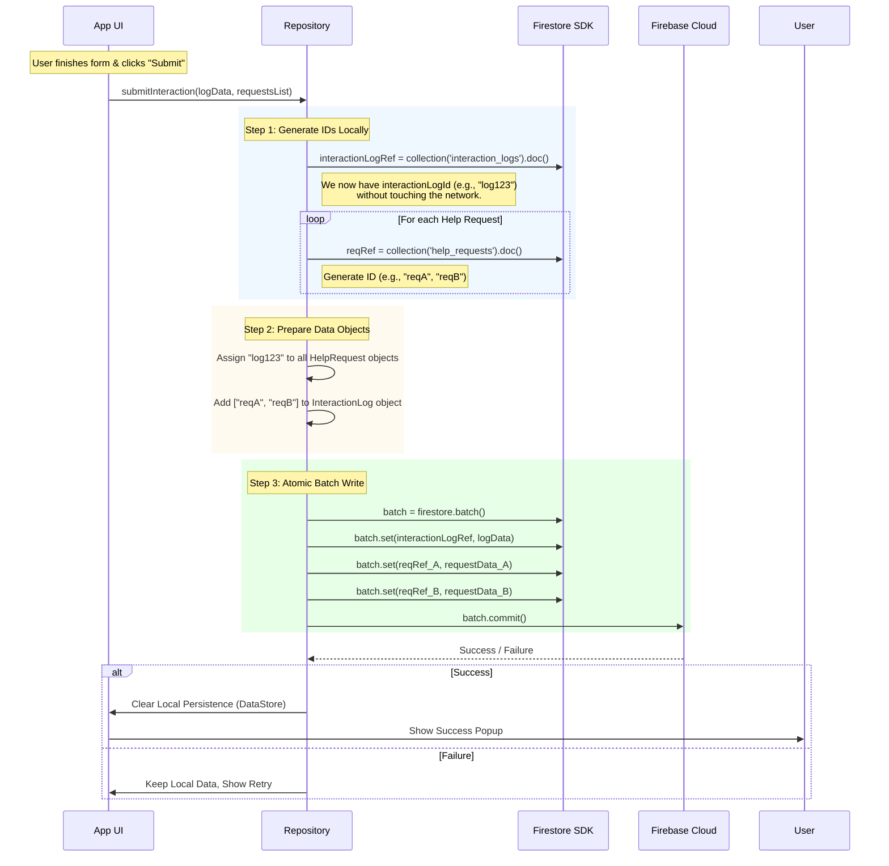

# InteractionLog and HelpRequests Insertion to Firestore

## 1. Overview
This document outlines the strategy for persisting **Interaction Logs** (Part 1: General Visit) and **Help Requests** (Part 2: Individual Interactions) to ensure data integrity and a crash-proof user experience.

We utilize a **Single-State Offline Persistence** model for drafting and an **Atomic Batch Write** strategy for the final commitment to Firestore.

---

## 2. Refer the Offline Persistence Strategy defined [here](https://github.com/BrightMindEnrichment/street-care-mobile-apps-wiki/blob/main/features/Persistence%20Strategy.md)
1.  **For storage:** The entire form state (Interaction Log + List of Help Requests) is serialized to JSON and saved to the device's native Key-Value store. _Have a separate helper class handling these operations._
1.  **Restoration:** On app launch, the app checks this Key-Value store. If data exists, the form is pre-filled, returning the user exactly to where they left off.
1.  **Cleanup:** Local storage is **only** cleared after a successful HTTP 200 OK / Success callback from the Firestore Batch Commit.

### Platform Implementation
* **Android:** `Jetpack DataStore` (Proto or Preferences).
* **iOS:** `UserDefaults` (standard `Codable` structs). 

---

## 3. Firestore Insertion Strategy: Atomic Batch
We utilize Firestore's ability to **generate Document IDs client-side**. This allows us to link documents locally and commit them all at once.

### The Data Structure
* **Collection `interaction_logs`:** Contains the general details (Location, Date, Total People, etc.).
* **Collection `help_requests`:** Contains specific details for individuals (Name, Needs, Demographics).
* **Linking:**
    * Each `HelpRequest` document stores `interactionLogId`.
    * The `InteractionLog` document stores an array of `helpRequestIds`.
 
### Why Linking? (Bidirectional References)
Since Firestore is a **Document Store (NoSQL)**, we prioritize read efficiency over normalized data storage:
1.  **Redundancy is Acceptable:** References in both directions optimize read performance.
2.  **Tabular Display:** The `helpRequestIds` array on the Log allows us to easily fetch and display associated requests in a table view.
3.  **Traceability:** The `interactionLogId` on the Request allows us to identify *who* captured the data and *when* the visit occurred.

### The Sequence: Client-Side ID Generation
By generating IDs locally, we eliminate the need for a network round-trip just to establish relationships.

#### Sequence Diagram


## 4. Implementation Methodology (Task Breakdown)

To adopt this strategy, team members should follow these guidelines based on their component focus:

### 📱 UI / Frontend Developers
* **Task:** Implement the "Auto-Save" watcher.
* **Action:**
    * Observe the `ViewModel` state.
    * On *any* change, serialize the current state to JSON.
    * Write to `DataStore` (Android) or `UserDefaults` (iOS) asynchronously.
* **Constraint:** Do not wait for a "Next" button click to save. Save on the fly, but with a 2 second delay between strokes. Hitting "Next" or changing screens should save again.

### ⚙️ Repository / Backend Developers
* **Task:** Implement the `submitInteraction` function using `WriteBatch`.
* **Action:**
    1.  **Do not** call `.add()` (which writes immediately).
    2.  Use `.doc()` on the CollectionReference to generate a `DocumentReference` (which contains a random ID) *purely in memory*.
    3.  Extract these IDs (`ref.id`) to populate your foreign keys (`interactionLogId` inside HelpRequests).
    4.  Instantiate a `WriteBatch`.
    5.  Queue all `.set()` operations on the batch.
    6.  Return the result of `batch.commit()`.

### 🛡️ QA / Testing
* **Test Case 1 (Crash):** Fill out half the form, force-close the app, reopen. **Expectation:** App loads to the Form with pre-filled fields.
* **Test Case 2 (Atomic Failure):** Simulate network failure during `batch.commit()`. **Expectation:** Neither the Log nor the Requests appear in Firestore (All or Nothing).
* **Test Case 3 (Linking):** Submit a form with 2 help requests. Check Firestore console. **Expectation:** `InteractionLog/HelpRequestDocIds` has an array containing the IDs of the two `HelpRequestDocId`s, and those documents exist.

---

## 5. Code Reference (Android Kotlin Example)

```kotlin
fun saveInteraction(log: InteractionLog, requests: List<HelpRequest>) {
    val db = Firebase.firestore
    val batch = db.batch()

    // 1. Generate Log Reference (Client-side ID)
    val logRef = db.collection("interaction_logs").document()
    val logId = logRef.id

    // 2. Prepare Help Request References & Data
    val requestIds = mutableListOf<String>()
    
    requests.forEach { request ->
        val reqRef = db.collection("help_requests").document()
        requestIds.add(reqRef.id)
        
        // Link Request to Log
        val linkedRequest = request.copy(interactionLogId = logId)
        batch.set(reqRef, linkedRequest)
    }

    // 3. Link Log to Requests & Queue in Batch
    val linkedLog = log.copy(helpRequestIds = requestIds)
    batch.set(logRef, linkedLog)

    // 4. Atomic Commit
    batch.commit()
        .addOnSuccessListener { 
            // Clear DataStore here
        }
        .addOnFailureListener { e ->
            // Handle error
        }
}
```
